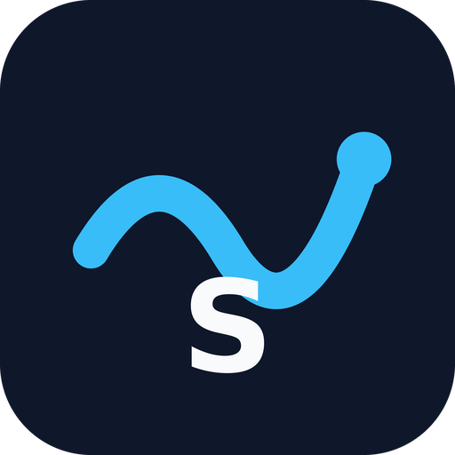
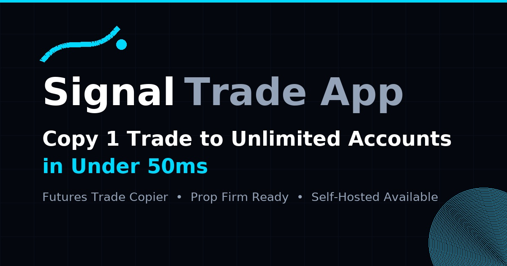

  

<h1 align="center">Signal Trade App</h1>

<b>Copy 1 trade to unlimited accounts in under 50ms.</b> 
The cloud futures trade copier for prop firm traders on Tradovate and Rithmic.

  
  
  

  

### Why traders use Signal Trade App

- ☁️ **Runs 24/7 in the cloud:** copy groups stay live with your PC off.
- 🔁 **Cross-broker copying:** Rithmic ↔ Tradovate in one group, with unlimited followers.
- ⚡ **Fast:** under 50 ms to Tradovate and under 5 ms to Rithmic.
- 🛡️ **Prop firm risk tools:** Daily P&L Lock, drawdown tracking, account lockouts and Protect.
- 🎯 **Per-instrument rules:** separate ratios per instrument, plus mini → micro copying.
- 📒 **Trading journal:** automatic import, with analytics, a P&L calendar and shareable P&L cards.
- 📈 **TradingView webhooks**, a full **API** and a read-only **MCP server** for AI assistants.

**Pro is $29/month for unlimited accounts**, with a 5-day free trial. Self-hosted is $599 one-time. Prop firms can [white-label it](https://signaltradeapp.com/prop-firm-platform).
➡️ [Get started](https://signaltradeapp.com/register) · [User guide](https://signaltradeapp.com/user-guide) · [Docs & support](https://github.com/signaltradeapp/signaltradeapp)
